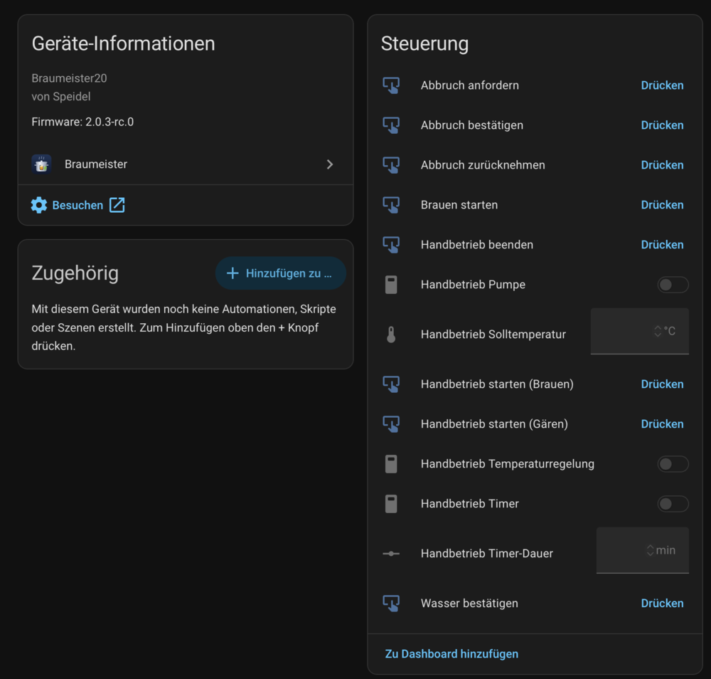
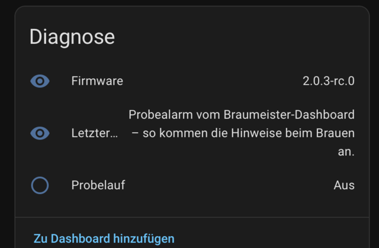

  

<h1 align="center">Braumeister für Home Assistant</h1>

<b>Dein Speidel Braumeister – live in Home Assistant.</b> 
Temperatur, Zustand, Fortschritt und Warnungen im Blick, Steuerung per Knopfdruck.

---

## ✨ Was kann die Integration?

- 🌡️ **Live-Werte:** Temperatur, Solltemperatur, Phase, Rezept, Fortschritt und Restzeiten
- 🔔 **Warnungen:** zum Beispiel „Deckel entfernen“ – ideal für Handy-Meldungen und Automationen
- 🎛️ **Steuerung:** Brauen starten, Abbruch, Handbetrieb mit Pumpe, Temperatur und Timer
- 🏠 **Automationen:** zum Beispiel Licht an, wenn der Sud fertig ist, oder eine Meldung bei erreichter Temperatur
- 📋 **Brausession:** laufende Session und Fortschritt deiner Checkliste

## 📸 So sieht es aus

**Steuerung** – alle Befehle und Handbetrieb-Einstellungen auf einen Blick:

**Sensoren** – Zustand, Temperatur, Fortschritt und mehr:

**Diagnose** – Firmware, letzter Handy-Hinweis und Probelauf:

## 📦 Voraussetzungen

- Home Assistant **2025.1** oder neuer mit installiertem [HACS](https://hacs.xyz)
- Entweder dein **My-Speidel-Zugang** (Benutzername, Passwort, Gerätenummer) – oder das **Braumeister-Dashboard** in deinem Heimnetz.

## 🔌 Zwei Wege zum Braumeister

| | **Direkt über My-Speidel** | **Über das Dashboard** |
|---|---|---|
| Was läuft dafür? | nichts – nur Home Assistant | das Braumeister-Dashboard auf einem Rechner im Heimnetz |
| Was brauchst du? | Benutzername, Passwort und Gerätenummer von My-Speidel | Adresse und Port des Dashboards |
| Alle Werte und Steuerung | ✅ | ✅ |
| Brausession, Checkliste, Hinweis-Verlauf | – | ✅ |

Für die meisten ist **„Direkt“** die einfachste Lösung. Das Dashboard brauchst du nur, wenn du seine Brausessions und die Checkliste in Home Assistant sehen willst.

## 🚀 Installation

1. In Home Assistant **HACS** öffnen, oben rechts das Menü (⋮) › **Benutzerdefinierte Repositories**.
2. Als Repository `https://github.com/tomfxs/braumeister-homeassistant` eintragen, als Kategorie **Integration** wählen und **Hinzufügen** klicken.
3. In HACS nach **Braumeister** suchen und **Herunterladen**.
4. Home Assistant **neu starten**.
5. *Einstellungen › Geräte & Dienste › Integration hinzufügen › Braumeister* und die Verbindungsart wählen:
   - **Direkt über My-Speidel:** Benutzername und Passwort von [myspeidel.com](https://www.myspeidel.com) sowie die **Gerätenummer** eintragen. Die Nummer steht in der Adresse deiner Steuerungsseite: `…/braumeister/control/`**`16014`**.
   - **Über das Dashboard:** Adresse und Port des Dashboards eintragen.

Fertig! Alle Entitäten erscheinen unter dem Gerät **Braumeister**.

## 🔄 Aktualisieren

In HACS den Eintrag **Braumeister** öffnen, auf **Aktualisieren** klicken und danach Home Assistant neu starten.
Wird kein Update angezeigt: oben rechts im Menü (⋮) **Repository aktualisieren** wählen.

## 🧾 Entitäten im Überblick

**Sensoren**
- Zustand, Phase, Rezept
- Temperatur, Solltemperatur
- Gesamtfortschritt, Phasenfortschritt
- Timer-Restzeit, Gesamt-Restzeit
- Warnung, Firmware
- nur mit Dashboard: Brausession, Checkliste erledigt, letzter Hinweis

**Binärsensoren**
- Online, Sud läuft, Handbetrieb
- Heizung, Pumpe, Timer läuft
- Wasser eingefüllt, Warnung aktiv
- nur mit Dashboard: Session läuft, Probelauf

**Schalter** (Handbetrieb)
- Pumpe, Temperaturregelung, Timer

**Zahlen** (Handbetrieb)
- Solltemperatur, Timer-Dauer in Minuten

**Buttons**
- Brauen starten
- Abbruch anfordern, bestätigen oder zurücknehmen
- Handbetrieb starten (Brauen oder Gären) und beenden
- Wasser bestätigen

**Dienst**
- `braumeister.start_recipe` – startet ein Rezept auf dem Braumeister (Angabe: Rezept-UUID aus My-Speidel)

Die Werte werden alle 5 Sekunden aktualisiert. Schalter, Zahlen und Buttons funktionieren nur, wenn der Braumeister im passenden Zustand ist (z. B. Handbetrieb für die Pumpe). Sonst zeigt Home Assistant eine Fehlermeldung an.

## ⚠️ Hinweise

- Direkt-Modus: Die Verbindung geht über die My-Speidel-Cloud. Ohne Internet oder bei einem Ausfall von My-Speidel gibt es keine Daten. Deine Zugangsdaten speichert Home Assistant wie bei jeder Integration in seiner Konfiguration.
- Dashboard-Modus: Das Dashboard hat keine Anmeldung und ist nur aus dem Heimnetz erreichbar. Gib den Port nicht im Router frei.
- Der Braumeister muss eingeschaltet sein und sich beim Dashboard melden, sonst steht **Online** auf „aus“.

## 🛠️ Probleme?

- **„Benutzername oder Passwort falsch“:** Melde dich zum Test auf myspeidel.com an. Ändert sich das Passwort später, fragt Home Assistant danach.
- **Direkt-Modus, Werte bleiben leer:** Stimmt die Gerätenummer? Ist der Braumeister eingeschaltet und mit dem WLAN verbunden?
- **„Dashboard nicht erreichbar“** bei der Einrichtung (Dashboard-Modus): Adresse und Port prüfen und testen, ob das Dashboard im Browser unter `http://<Adresse>:8080` erreichbar ist.
- **Werte bleiben leer:** Prüfen, ob der Braumeister online ist.
- **Fehler melden:** [GitHub Issues](https://github.com/tomfxs/braumeister-homeassistant/issues)
